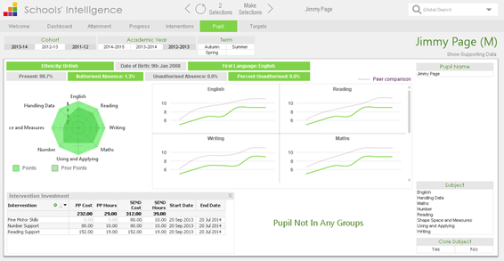
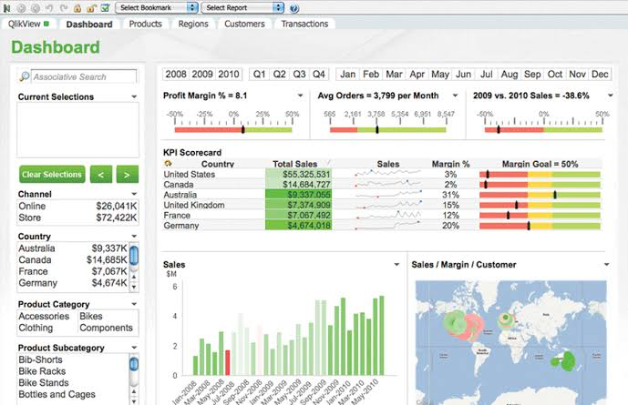
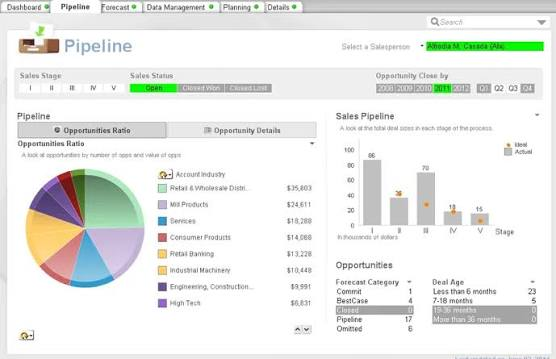

# QlikView Makes Business Measures Respond to Selections

QlikView Analytics combines scripted data preparation with associative exploration and guided dashboards. A useful application makes the relationship between a selection, its available records, and the resulting measure easy to explain.

## Compare a selected result with a fixed reference

### A small model with known totals

Use an isolated demonstration document to test expression behavior before introducing a production model.
This QlikView load script creates four sales records with a total of 700:

```qlik
SalesDemo:
LOAD * INLINE [
Region, Product, Sales
North, Hardware, 120
North, Services, 180
South, Hardware, 250
South, Services, 150
];
```

The [inline-load reference](https://help.qlik.com/en-US/qlikview/September2026/Subsystems/Client/Content/QV_QlikView/Scripting/inline-loads-qv.htm) explains this embedded table syntax.
Keep the example in its own document so similarly named fields do not associate with unrelated data.

### Two measures that answer different questions

Add two text objects and enter one expression in each:

```qlik
=Sum(Sales)
=Sum({1} Sales)
```

The first expression follows the current selections; the second uses the full available record set.
The [set-analysis documentation](https://help.qlik.com/en-US/qlikview/September2026/Subsystems/Client/Content/QV_QlikView/ChartFunctions/SetAnalysis/set-analysis-expressions.htm) explains set identifiers.
Label the objects clearly so a fixed reference is not mistaken for an unresponsive selection.

| Selections in the isolated demo | Current-selection sum | Full-set reference |
| --- | ---: | ---: |
| None | 700 | 700 |
| Region = North | 300 | 700 |
| Product = Hardware | 370 | 700 |
| Region = South and Product = Services | 150 | 700 |

These expected values apply to the four records above and text objects without chart dimensions.
A full-set expression does not grant access to data excluded by authorization.

[](https://qlikview-analytics.github.io/QlikView-Software/)

## Make field relationships deliberate

A QlikView application associates tables through shared field names.
Inspect which fields represent business keys and which merely happen to have the same label.
Order dates and shipping dates, for example, can serve different analytical roles.

### Review the model before adding more charts

Check the grain of each table, the uniqueness of dimension keys, and the intended relationship to facts.
If two tables share multiple fields, inspect any synthetic key and decide whether that relationship is intentional.
Qlik's [synthetic-key guidance](https://help.qlik.com/en-US/qlikview/September2026/Subsystems/Client/Content/QV_QlikView/Scripting/synthetic-keys.htm) describes the conditions that create these keys.

The companion diagram [erd.puml](scripts/erd/erd.puml) describes Superset's application metadata entities.
Its generator [erd.py](scripts/erd/erd.py) introspects SQLAlchemy models.
The rendering template [erd.plantuml.template](scripts/templates/erd.plantuml.template) organizes those entities into a diagram.
Use these as examples of schema documentation, keeping application metadata distinct from the sales model being analyzed.



### Identify the actual source of each loaded table

Record the connection, source object, extraction rules, and expected refresh window.
Reconcile record counts and business totals after transformations.
Confirm how missing identifiers, duplicates, and mixed date formats affect the result.

For a separate database example, [docker-compose.yml](scripts/databases/hive/docker-compose.yml) defines a Hadoop and Hive environment.
The accompanying [hadoop-hive.env](scripts/databases/hive/hadoop-hive.env) supplies service settings.
Its [startup.sh](scripts/databases/hive/startup.sh) prepares warehouse directories and starts HiveServer2.
These files illustrate source-environment dependencies rather than QlikView connection definitions.

## Treat a reload as a measurable operation

A QlikView Software document can display an older loaded state even when the underlying source has changed.
Show the relevant data period and record when the reload completed successfully.
Separate a source-data problem from an expression or layout problem during investigation.

With QlikView Desktop installed in the usual Program Files location, this PowerShell example reloads an existing document and closes the application:

```powershell
$qv = Join-Path $env:ProgramFiles 'QlikView\Qv.exe'
& $qv /r '.\SalesReview.qvw'
```

Adjust the executable location if necessary and use a document whose script and connections you have reviewed.
The [QlikView command-line reference](https://help.qlik.com/en-US/qlikview/September2026/Subsystems/Client/Content/QV_QlikView/Starting_QlikView.htm) documents the native /r switch.
Check the resulting document and reload log; process completion alone does not prove that the intended data was loaded.

Environment-specific settings are represented in the companion [superset_config.py](docker/pythonpath_dev/superset_config.py).
Its override example [superset_config_local.example](docker/pythonpath_dev/superset_config_local.example) illustrates a local database configuration.
The chart schema [values.schema.json](helm/superset/values.schema.json) describes accepted deployment values.

Two focused references show how configuration output can be checked:
[config_test.yaml](helm/superset/tests/config_test.yaml) covers generated application settings, while [secret_env_test.yaml](helm/superset/tests/secret_env_test.yaml) checks environment-secret mappings.
Keep test-environment credentials and production connection settings separate.



## Design the consumer view around permissions and context

For qlikview bi reporting, distinguish permission to open a document from permission to see its underlying rows and fields.
QlikView Server provides document authorization, while Section Access can define data-level restrictions.
Review the [server security documentation](https://help.qlik.com/en-US/qlikview/September2026/Subsystems/Server/Content/QV_Server/QlikView-Server/QVSRM_Security.htm) when defining those boundaries.

- Test with a representative consumer account.
- Confirm that restricted data remains unavailable after selections are cleared.
- Verify the intended documents appear through AccessPoint.
- Include the selected period and filters when explaining an exported result.

The role matrix [STANDARD_ROLES.md](RESOURCES/STANDARD_ROLES.md) describes Superset permissions for several audiences.
The maintenance utility [permissions_cleanup.py](scripts/permissions_cleanup.py) handles duplicate permission-view records in that platform.
These references help compare authorization models without equating their role names.

Document how readers should interpret measures that deliberately ignore a selection.
Use consistent units, number formats, and labels across related sheets.
The mapping example [superset_text.yml](superset_text.yml) illustrates database-image customization in a companion interface.



## Review changes against the business question

When a source, key, expression, or access rule changes, repeat the relevant analytical checks.
Keep known-answer cases like the four-row example alongside the application's acceptance criteria.
Use the qlikview community for product-specific discussion and the documentation for the installed version.

The companion [change_detector.py](scripts/change_detector.py) classifies repository changes for CI decisions.
The utility [benchmark_migration.py](scripts/benchmark_migration.py) measures database migration behavior.
The flag extractor [extract_feature_flags.py](scripts/extract_feature_flags.py) builds metadata for feature documentation.
The testing guide [README.md](scripts/tests/README.md) describes the utility test runner and its database prerequisites.

For a reproducible companion environment, [base.in](requirements/base.in) declares dependency constraints.
The dependency guide [README.md](requirements/README.md) explains how input requirements become pinned files.
Keep these implementation references separate from the checks that establish whether a business measure is correct.

## Related Search Terms

QlikView Analytics, QlikView Software, qlikview bi, qlikview application, qlikview community, business-intelligence, data-analytics, data-visualization, dashboards, reporting, etl, data-modeling, associative-analytics, data-governance, sql
